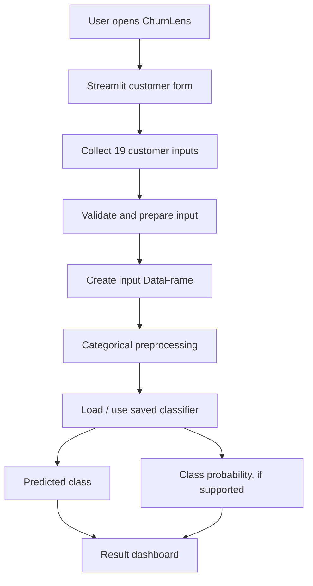

## 🎯 Project Objectives

The primary objective of **ChurnLens** is to develop an end-to-end Machine Learning application that analyzes customer-related information and estimates the likelihood of customer churn using account, service, contract, and billing attributes.

The project aims to demonstrate how machine learning can be integrated into a practical application to transform structured customer data into predictive insights through an interactive and accessible interface.

### 1. Predict Customer Churn

Develop a classification-based system capable of processing customer profiles and predicting the class returned by the deployed Machine Learning model.

The application is designed to explore whether a customer profile is associated with churn-related patterns learned during model training.

### 2. Understand Customer Data

Work with structured customer data containing demographic-style attributes, account tenure, subscribed services, contract details, payment information, and billing characteristics.

The project focuses on understanding how different customer attributes are represented, prepared, and supplied to a machine learning model.

### 3. Implement an End-to-End Machine Learning Workflow

Demonstrate the practical stages involved in building and deploying a machine learning application, including:

- Loading and validating structured datasets.
- Preparing input features for prediction.
- Handling categorical and numerical data.
- Maintaining compatibility between input features and the model's expected schema.
- Loading a serialized model.
- Generating predictions through model inference.
- Integrating the prediction workflow into a Streamlit application.

### 4. Explore Model-Estimated Churn Probability

Where the deployed model supports probability estimation, provide a probability-based output to help users understand the model's estimated likelihood of a particular class.

This probability is intended to provide additional context beyond a simple class prediction. It should not be interpreted as a guaranteed outcome or a perfectly calibrated measure of customer churn risk.

### 5. Translate Predictions into an Understandable Interface

Make Machine Learning predictions accessible through a browser-based application rather than requiring users to execute Python scripts manually.

The interface allows users to enter customer information, submit a profile, and view the model's output in a structured and understandable format.

### 6. Explore Customer Risk Categorization

Present probability-based outputs through visual indicators and configurable risk categories such as **Low, Moderate, and High**.

These categories are intended to simplify interpretation of model output. They represent application-defined thresholds and should not be considered independently validated business risk levels.

### 7. Demonstrate Practical Model Deployment

Deploy the application using Streamlit Community Cloud and make the prediction interface accessible through a public web URL.

This objective demonstrates the transition from a locally developed Machine Learning workflow to a deployed application that can be accessed through a web browser.

### 8. Build a Reusable Prediction Application

Organize the project into a maintainable structure that can support future improvements, including:

- Consistent input validation.
- Improved preprocessing pipelines.
- Model replacement or retraining.
- Batch prediction functionality.
- Additional evaluation metrics.
- Better prediction explanations.
- Future integration with other applications or services.

### 9. Understand the Limitations of Machine Learning Predictions

Recognize that a prediction depends on the dataset, training process, preprocessing implementation, model configuration, and quality of the input information.

ChurnLens is a learning and demonstration project. Its outputs should not be used as the sole basis for customer retention, financial, or operational decisions without proper model validation and business evaluation.

### Project Outcome

ChurnLens demonstrates the practical implementation of a Machine Learning application—from structured customer data and model inference to an interactive interface and cloud deployment.

The project provides a foundation for further exploration of predictive analytics, model evaluation, customer behavior analysis, and responsible use of Machine Learning in business-oriented applications.

📌 Project Overview
What is customer churn?
Customer churn occurs when a customer stops using a company's product or service—for example, cancelling an internet subscription, switching telecom providers, or discontinuing a paid service.

Customer churn prediction is a binary classification problem when the target contains two classes, commonly representing customers who left (Yes) and customers who stayed (No). The exact target encoding must be confirmed from the dataset and training process.
What does ChurnLens do?
ChurnLens provides a browser-based interface for entering a customer profile. The application prepares the submitted data, applies its implemented preprocessing steps, and passes the prepared features to a saved classification model.

Depending on the model and its supported methods, the application displays:
1. Predicted class.
2. Estimated churn probability.
3. A visual probability/risk indicator.
Why is churn prediction useful?
Validated churn estimates can help a business investigate customer experience, identify patterns in customers who leave, and explore retention strategies. Predictions should be treated as signals for further analysis—not guarantees about an individual customer's behaviour.
🎯 Project Objectives
- Explore and understand customer churn data.
- Identify the target column and predictive features.
- Validate the dataset schema and numeric fields.
- Prepare model inputs while excluding the target and non-predictive identifiers where appropriate.
- Convert categorical inputs into the representation expected by the trained model.
- Load a saved model and perform inference on customer records.
- Display churn probability only when the correct class is identified and the model supports probability prediction.
- Build an accessible, interactive interface using Streamlit.
- Deploy the application for browser-based access.
- Document model limitations and verification requirements.
📂 Dataset Information
The application expects a CSV file named IT_customer_churn.csv.
Attribute	Description
Dataset file	IT_customer_churn.csv
Target column	Churn
Format	Structured/tabular CSV
Problem type	Binary classification, if the target contains two classes
Domain	Customer analytics / churn prediction
Identifier	customerID (excluded from features if present)

Target variable
The target variable is the value the model is trained to predict. In this project, Churn is intended to represent whether a customer left the service.

Example labels may be Yes and No, but the actual target values and their encoding must be confirmed in the dataset and model-training code.
Why exclude customerID?
A customer identifier is generally a record ID rather than a meaningful behavioural feature. Including an arbitrary identifier can introduce patterns that fail to generalize. The application excludes customerID from its feature inputs if the column is present.
Dataset preparation performed by the application
- Loads the CSV using Pandas.
- Strips leading and trailing whitespace from column names.
- Converts TotalCharges to numeric values where possible.
- Removes rows with missing TotalCharges before constructing categorical encoder classes.
These are basic preparation steps; they do not replace a complete data-quality or training pipeline.
🧾 Input Features
The app collects 19 customer attributes. The available values and data types must match the model's training schema.
Feature	Description	Example values
gender	Gender category as recorded in the dataset	Female, Male
SeniorCitizen	Senior-citizen indicator	0, 1
Partner	Whether the customer has a partner	Yes, No
Dependents	Whether the customer has dependents	Yes, No
tenure	Number of months with the provider	0–`72` in the current form
PhoneService	Whether phone service is active	Yes, No
MultipleLines	Multiple phone lines or no-service category	Yes, No, No phone service
InternetService	Internet service type	DSL, Fiber optic, No
OnlineSecurity	Online security service selection	Yes, No, No internet service
OnlineBackup	Online backup service selection	Yes, No, No internet service
DeviceProtection	Device protection selection	Yes, No, No internet service
TechSupport	Technical support selection	Yes, No, No internet service
StreamingTV	TV streaming selection	Yes, No, No internet service
StreamingMovies	Movie streaming selection	Yes, No, No internet service
Contract	Contract duration	Month-to-month, One year, Two year
PaperlessBilling	Paperless billing indicator	Yes, No
PaymentMethod	Customer payment method	Electronic check, Mailed check, Bank transfer (automatic), Credit card (automatic)
MonthlyCharges	Current monthly charge	Non-negative numeric value
TotalCharges	Accumulated customer charges	Non-negative numeric value

Why do these features matter?
These attributes describe different parts of a customer relationship: tenure, services, contract commitment, and billing behaviour. A trained model may learn statistical relationships between these attributes and the churn labels. Feature relationships are not automatically causal.
⚙️ Application Workflow
The application follows this high-level process:
1. Load files: locate the dataset and saved model relative to the application directory.
2. Validate dataset: check required columns and normalize column-name whitespace.
3. Prepare feature list: exclude the target (Churn) and the identifier (customerID) where present.
4. Separate data types: identify numeric and categorical columns according to the current implementation and training schema.
5. Build categorical encoders: the current approach reconstructs categorical encoder classes from dataset values.
6. Check model schema: compare expected feature count and feature names/order when the estimator exposes those attributes.
7. Collect customer inputs: the Streamlit form gathers the 19 profile values.
8. Build input DataFrame: arrange submitted values into one record in the expected feature order.
9. Encode input: convert categorical values to the model's expected numeric representation.
10. Predict: call the estimator's predict() method and, if supported, predict_proba().
11. Display result: show the predicted class, estimated probability, and visual risk indicator.
Workflow diagram

🧠 Prediction and Probability
predict()
The model's predict() method returns a predicted class for the supplied customer record. The meaning of the returned class depends on how the target was encoded during training.
predict_proba()
If the estimator supports predict_proba(), it returns probabilities for its classes. The application must identify the correct churn class and use the corresponding probability index.

For example, if the model classes are ordered as:
model.classes_  # Example: ['No', 'Yes']
and the probability output is:
[0.18, 0.82]
then 0.82 represents the estimated probability for Yes only if the class order shown above is confirmed and Yes means churn in the training target.
Model-estimated probabilities are not automatically calibrated and do not guarantee that an individual customer will churn.

Risk labels
The UI may map probabilities to labels such as Low, Moderate, or High. These are display thresholds. They should be validated against evaluation data and business needs before being used for operational decisions.
🏗️ High-Level Architecture
Browser / User
     |
     v
Streamlit Interface
     |
     v
Customer Profile Form
     |
     v
Input Validation & DataFrame Creation
     |
     v
Categorical Preprocessing
     |
     v
Saved Classification Model
     |----------------------|
     v                      v
Predicted Class       Class Probability
     |                      |
     |----------------------|
              |
              v
     Churn Result & Risk Visualization
📁 Project Structure
churnlens/
├── app.py
├── requirements.txt
├── IT_customer_churn.csv
├── best_fraud_model.pkl
└── README.md
File	Purpose
app.py	Streamlit UI, file loading, validation, feature preparation, model inference, and result rendering
requirements.txt	Python dependencies required to run/deploy the application
IT_customer_churn.csv	Dataset used to inspect the schema and reconstruct categorical encoder classes
best_fraud_model.pkl	Serialized estimator currently referenced by the app; verify that it is a churn-trained model
README.md	Project documentation and setup instructions

⚠️ Model filename notice
The model filename best_fraud_model.pkl includes the word fraud, while this application is described as customer churn prediction. A filename alone cannot establish the model's target. Verify the training code, target variable, features, and model classes. If it is actually a fraud-detection model, it must not be used for churn prediction.
💻 Run Locally
Prerequisites
- Python version compatible with the serialized model and installed ML libraries.
- pip.
- Project dataset and trusted model file.
- Project files in the expected directory.
1. Clone or download the repository
git clone <YOUR_REPOSITORY_URL>
cd churnlens
Replace <YOUR_REPOSITORY_URL> with your GitHub repository URL.
2. Create a virtual environment
Windows (PowerShell):
python -m venv .venv
.\.venv\Scripts\Activate.ps1
Windows (Command Prompt):
python -m venv .venv
.venv\Scripts\activate.bat
macOS / Linux:
python3 -m venv .venv
source .venv/bin/activate
3. Install dependencies
python -m pip install --upgrade pip
python -m pip install -r requirements.txt
Ensure requirements.txt includes the libraries needed by the app and saved model, such as Streamlit, Pandas, scikit-learn, Joblib, and XGBoost if required. Use compatible versions for reproducible deployment.
4. Start the app
python -m streamlit run app.py
5. Open in your browser
Streamlit will print a local address, commonly:
http://localhost:8501
Open that URL, complete the customer form, and submit a prediction.
☁️ Deployment — Streamlit Community Cloud
The app is hosted using Streamlit Community Cloud.
Deployment steps
1. Make sure the repository contains the application file, dependency file, dataset, model file, and README.
2. Confirm that you are authorized to publish the dataset and model. Never commit credentials, secrets, or private customer information.
3. Push the project to GitHub.
4. Visit Streamlit Community Cloud.
5. Sign in and connect your GitHub account.
6. Select the repository and deployment branch.
7. Set the main application file to app.py.
8. Deploy the application.
9. Review logs if the build or app startup fails.
A successful deployment confirms that the application started; it does not independently prove model quality or prediction correctness.
🔍 Model Verification & Limitations
Before relying on the prediction output, verify the following:
- [ ] The saved model was trained for customer churn prediction with the intended target.
- [ ] The target labels and class mapping are understood (e.g., which class means churn).
- [ ] The exact training feature list is known.
- [ ] The feature names and order at inference match training.
- [ ] Categorical encoding and missing-value handling match the training pipeline.
- [ ] Numeric transformations, scaling, and other preprocessing match training if used.
- [ ] Predictions have been tested against known records through the original training pipeline.
- [ ] The model has been evaluated on held-out data.
- [ ] Risk thresholds have been validated for the intended use case.
Preprocessing compatibility
The current implementation fits categorical LabelEncoder objects using categories from the CSV at application runtime. This is safe only if those category-to-number mappings are exactly compatible with the model's training process. Re-fitting encoders during inference can cause incorrect predictions even when the app runs successfully.
Recommended production approach
For a more robust implementation, fit preprocessing and the estimator together in a scikit-learn Pipeline, save the fitted pipeline, and load that pipeline during inference. The app should pass raw input values using the expected feature names and let the saved pipeline perform the transformations.
Model evaluation
Accuracy alone may not be sufficient for churn prediction. Consider evaluating:
- Precision: among customers predicted to churn, how many actually churned?
- Recall: among actual churners, how many did the model identify?
- F1-score: balance between precision and recall.
- ROC-AUC: ranking/discrimination performance across thresholds.
- Confusion matrix: counts of correct and incorrect class predictions.
Metric selection should reflect the business cost of missed churners and unnecessary retention interventions.
🛠️ Troubleshooting
Dataset file not found
Possible cause: CSV is missing, located in another directory, or named differently.

Check:
- Is IT_customer_churn.csv next to app.py?
- Does the filename and capitalization match?
- Is the configured dataset path correct?
Model file not found
Possible cause: Saved model is missing or its path/name is incorrect.

Check:
- Does the expected model file exist?
- Is MODEL_PATH configured correctly?
- Only load trusted Joblib/pickle files; untrusted serialized files may execute malicious code during loading.
Required dataset columns are missing
Possible cause: CSV headers differ from the expected schema or include whitespace.

Check:
print(df.columns.tolist())
Normalize surrounding whitespace and compare the dataset schema with the required features. Do not remove validation checks without confirming the model's schema.
Feature count/order mismatch
Possible cause: The model was trained on a different feature set, an identifier was included/excluded inconsistently, or preprocessing differs.

Check: Compare the exact training feature list and inference feature list. Preserve the training order; do not remove features just to silence the error.
Prediction fails or appears incorrect
Possible cause: Model identity, feature encoding, class mapping, or feature order may be incompatible.

Check: Verify the model's training target, preprocessing, positive class, and test known validation examples through the original pipeline.
Dependency or XGBoost issue
Possible cause: Missing dependency or incompatible package versions.

Check: Install the model's required packages and use versions compatible with the training environment. Add XGBoost to requirements.txt only if the estimator requires it.
Deployment fails
Check: Read the deployment logs and identify the first relevant error. Verify file paths, dependency versions, and that all required files are committed. Push the fix and redeploy.
🌱 Future Improvements
1. Save the fitted preprocessing and model together as a single pipeline.
2. Add model evaluation metrics and a confusion matrix.
3. Validate and, if appropriate, calibrate probability estimates.
4. Validate Low/Moderate/High risk thresholds against evaluation data and the business context.
5. Add automated tests for required inputs, category handling, feature schema, and predictions.
6. Pin dependency versions for more reproducible deployments.
7. Add batch prediction for uploaded customer CSV files.
8. Allow safe download/export of prediction results.
9. Monitor data drift and model performance after deployment.
10. Add a model card documenting training data, evaluation, intended use, and limitations.
💡 Why This Project Is Valuable
- End-to-end ML workflow: connects data preparation, preprocessing, inference, UI, and deployment.
- Practical ML integration: demonstrates how a saved model can be used outside a notebook.
- Data handling: includes CSV loading, schema checks, and categorical data preparation.
- Application development: turns model inference into an interactive Streamlit application.
- Deployment practice: demonstrates GitHub-based cloud deployment.
- Portfolio foundation: provides a base for stronger evaluation, testing, monitoring, and production-oriented ML practices.
✅ Conclusion
ChurnLens demonstrates how a classification model can be integrated into an interactive Streamlit application to estimate customer churn. The project brings together Python, Pandas, preprocessing, model inference, probability display, UI development, and cloud deployment.

For trustworthy results, the model's training target, feature schema, preprocessing, class mapping, and evaluation performance must be verified. These checks are essential before using the output for customer or business decisions.
👨‍💻 Author
Rishu Gurjar
B.Tech Computer Science Engineering Student
Python Developer | Data Analyst | Machine Learning Enthusiast

I am interested in building practical applications using Python, Data Analytics, Machine Learning, and AI. I enjoy developing end-to-end projects that connect data processing and trained models with usable applications.
Connect with me
- GitHub: https://github.com/Rishu6262
- LinkedIn: https://www.linkedin.com/in/rishu-gurjar-58072a333/
- Kaggle: https://www.kaggle.com/rishugurjar
⭐ If you find this project useful, consider starring the repository and sharing feedback.
